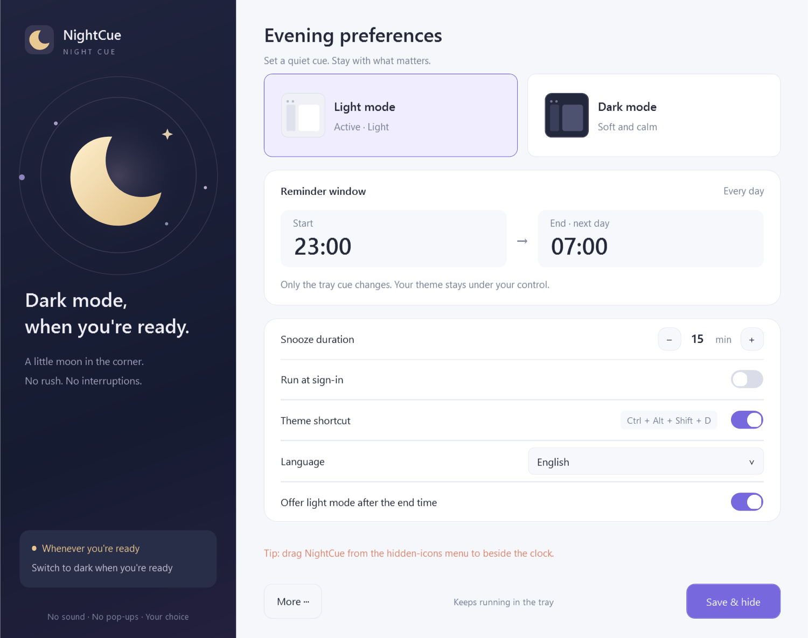
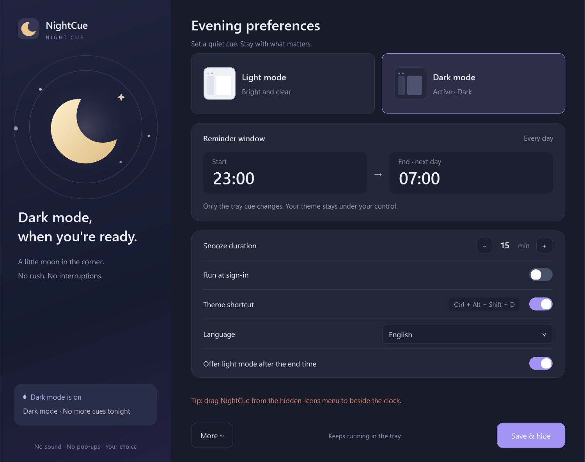

# NightCue · 夜色提醒

**A quiet reminder to switch themes when you turn off the lights.**

English · [简体中文](README.zh-CN.md) · [MIT license](LICENSE)

NightCue is a small Windows tray app for people whose room lighting does not follow a fixed schedule. At night, an amber moon waits beside the clock. Switch to dark mode when you are ready, snooze the cue, or keep the light theme for tonight. After the end time, a gold sun can offer light mode just as quietly.

There are no sounds, notification banners, flashing icons, or automatic theme changes. The app does not try to infer whether you are focused or whether your room lights are on.



<details>
<summary>Dark appearance</summary>



</details>

## Features

- Configurable reminder window, **23:00–07:00** by default; supports crossing midnight.
- A steady amber moon for the night cue and a gold sun for the light-mode cue after the end time.
- Switch both Windows and app themes manually, using the tray menu or **Ctrl + Alt + Shift + D**.
- Snooze for **15 minutes** by default, adjustable from 1 to 120 minutes.
- Keep light mode tonight or keep dark mode until the next start time. Night and daytime choices and snoozes are independent and survive restarts.
- Optional light-mode reminder after the end time, enabled by default. Neither cue changes the theme automatically.
- Optional sign-in startup, local settings, and light/dark settings-window styling.

One executable includes **English, Simplified Chinese, Traditional Chinese, Japanese, Korean, German, French, Spanish, Brazilian Portuguese and Russian**. It follows the Windows display language by default, with English as fallback. Choose a language in Settings to preview it immediately; save to keep it, or close without saving to restore the previous choice. No separate language downloads are needed. [Language and font behavior](docs/LOCALIZATION.md).

The default morning cue appears from **07:00 until the next 23:00** if the theme is still dark. You can switch to light, snooze, keep dark for this period, or disable this cue in Settings.

## Get started

Download `NightCue-v1.3.1-windows-portable.zip` from this repository's **Releases** section once a release has been published. If none is available, build from source below.

1. Extract the entire ZIP to a folder you can write to. Keep this folder in a stable location if you enable sign-in startup.
2. Run `NightCue.exe`. No administrator access is needed.
3. Make NightCue visible next to the clock using Windows taskbar settings or by dragging it out of the hidden-icons menu. The tray menu includes visibility guidance; Windows controls pinning.
4. Left-click the tray icon to open **Settings**, adjust the times and language, then select **Save & hide**.

Left-click opens or activates Settings, recreates it after closing, and restores it when minimized. Right-click opens the quick menu for theme switching, snooze and Exit. This reopening behavior is fixed in **1.3.1**.

| Tray icon | Meaning |
| --- | --- |
| Amber moon | A night-theme choice is pending |
| Gold sun | A light-theme choice is pending after the end time |
| Gray ring | Waiting, snoozed, or dismissed for the current period |
| Blue moon | Dark mode, with no active cue |

“15 minutes” means the delay after you explicitly choose **Remind me in 15 min**. It is not a recurring pop-up. [English quick start](docs/QUICKSTART.en.txt) · [中文使用说明](docs/使用说明.txt).

## Requirements and limitations

- Windows 11 is the local development and test environment. Windows 10 with .NET Framework 4.8 is a compatibility target, but has not been tested on a Windows 10 machine. Windows ARM64 is also unverified. See the [compatibility matrix](docs/COMPATIBILITY.md) and [validation record](docs/VALIDATION.md) for the exact scope.
- Requires **.NET Framework 4.8 or later** with the Windows desktop components. The app is AnyCPU and has no third-party runtime packages.
- Apps and websites must support following the Windows theme. Fixed app themes are not overridden. Mixed Windows/app themes are treated as not fully dark.
- Disable competing theme schedules in PowerToys Light Switch or Auto Dark Mode to avoid conflicting changes.
- The current executable is unsigned; Windows may display a reputation warning. Verify the release checksum or build from source if needed.
- High-contrast mode, screen-reader support, and mixed-DPI multi-monitor layouts have not been comprehensively tested.

## Build and test

On Windows with .NET Framework 4.8 installed, open PowerShell in the repository root:

```powershell
.\build.ps1
```

The script compiles with the Windows .NET Framework compiler, checks repository metadata, and runs the regression suite without starting the tray app or modifying Windows settings. PowerShell 7 is locally verified. The scripts use PowerShell 5.1-compatible syntax; local execution policies still apply. If scripts are blocked, use your approved development environment or Visual Studio.

Outputs are `artifacts/app/NightCue.exe` and `artifacts/tests/NightCue.Tests.exe`. To use Visual Studio, open `NightCue.sln` with the **.NET desktop development** workload and **.NET Framework 4.8 targeting pack**, build Release, and run the test executable. [Contributor guide](CONTRIBUTING.md) covers both build paths.

```powershell
# Build, test, and create source + portable ZIPs and SHA-256 checksums
.\scripts\package.ps1
```

GitHub Actions checks both build paths on Windows and uploads packages as workflow artifacts. These are build artifacts; a maintainer publishes Releases separately. [Publishing guide / 发布指南](docs/PUBLISHING.md).

## Data, startup, and uninstall

NightCue makes no network requests and includes no analytics or automatic updater. It stores `settings.xml`, `state.xml`, and, on errors, `error.log` beside the executable. Logs can contain local paths: review them before posting publicly. Do not install into a read-only location such as Program Files.

Choosing a theme writes only the current user's `AppsUseLightTheme` and `SystemUsesLightTheme` values under `HKCU\Software\Microsoft\Windows\CurrentVersion\Themes\Personalize`. Enabling sign-in startup adds a `NightCue` value under `HKCU\Software\Microsoft\Windows\CurrentVersion\Run`. It does not install a service or scheduled task.

To uninstall, turn off **Run at sign-in**, save, choose **Exit** from the tray menu, then delete the extracted folder. Your current Windows theme remains as chosen. When upgrading, exit the old app and preserve `settings.xml` and `state.xml`. If you moved the folder, run the new copy, keep startup enabled and save: NightCue warns about the old path and updates it. If Windows has disabled the startup app in Task Manager, enable it there as well. Actual sign-in behavior still needs to be checked on your machine. [Troubleshooting](docs/TROUBLESHOOTING.md).

## Contributing

Bug reports, translations, accessibility improvements, and focused pull requests are welcome in English or Chinese. Start with the [architecture guide](docs/ARCHITECTURE.md), [translation guide](docs/LOCALIZATION.md), [CONTRIBUTING.md](CONTRIBUTING.md), [the code of conduct](CODE_OF_CONDUCT.md), and [the changelog](CHANGELOG.md). For security concerns, see [SECURITY.md](SECURITY.md).

## License

[MIT](LICENSE) · Copyright (c) 2026 NightCue contributors. Project code, original artwork, and documentation are covered by this license. Windows and .NET remain subject to their respective licenses.
