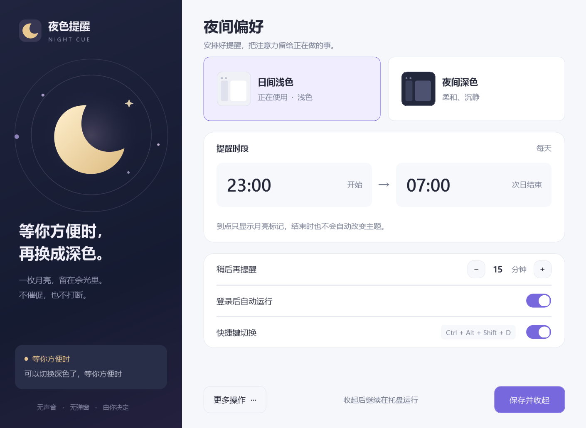
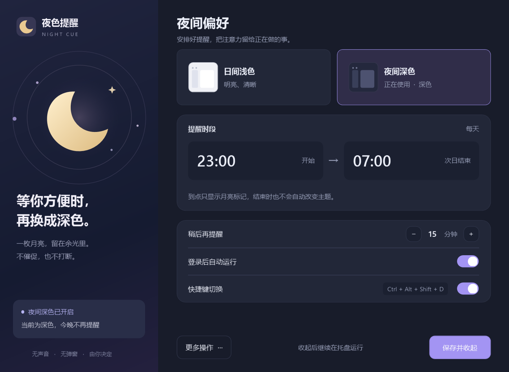

# NightCue · 夜色提醒

**A quiet reminder to switch themes when you turn off the lights.**

English · [简体中文](README.zh-CN.md) · [MIT license](LICENSE)

NightCue is a small Windows tray app for people whose room lighting does not follow a fixed schedule. At night, an amber moon waits in your taskbar. Switch to dark mode when you are ready, snooze the cue, or keep the light theme for tonight.

There are no sounds, notification banners, flashing icons, or automatic theme changes. The app does not try to infer whether you are focused or whether your room lights are on.



<details>
<summary>Dark appearance</summary>



</details>

## Features

- Configurable reminder window, **23:00–07:00** by default; supports crossing midnight.
- A steady amber tray icon while a choice is pending.
- Switch both Windows and app themes manually, using the tray menu or **Ctrl + Alt + Shift + D**.
- Snooze for **15 minutes** by default, adjustable from 1 to 120 minutes.
- Keep light mode tonight; decisions and snoozes survive restarts and midnight.
- Optional sign-in startup, local settings, and light/dark settings-window styling.

The interface is currently **Simplified Chinese**. Documentation and the quick start are available in English and Chinese. The end of the reminder window does **not** switch your theme back to light.

## Get started

Download `NightCue-v1.2.0-windows-portable.zip` from this repository's **Releases** section once a release has been published. If none is available, build from source below.

1. Extract the entire ZIP to a folder you can write to. Keep this folder in a stable location if you enable sign-in startup.
2. Run `NightCue.exe`. No administrator access is needed.
3. Make the moon icon visible next to the clock using Windows taskbar settings or by dragging it out of the overflow menu.
4. Adjust the reminder window in **设置** (Settings) and select **保存并收起** (Save settings).

| Tray icon | Meaning |
| --- | --- |
| Amber moon | A night-theme choice is pending |
| Gray ring | Outside the window, snoozed, or dismissed for tonight |
| Blue moon | Windows and app themes are both dark |

“15 minutes” means the delay after you explicitly choose **15 分钟后提醒**. It is not a recurring pop-up. [English quick start and menu translation](docs/QUICKSTART.en.txt) · [中文使用说明](docs/使用说明.txt).

## Requirements and limitations

- Windows 11 is the tested desktop environment. Windows 10 with .NET Framework 4.8 is a compatibility target, but has not been manually tested. Windows ARM64 has not been tested.
- Requires **.NET Framework 4.8 or later** with the Windows desktop components. The app is AnyCPU and has no third-party runtime packages.
- Apps and websites must support following the Windows theme. Fixed app themes are not overridden. Mixed Windows/app themes are treated as not fully dark.
- Disable competing theme schedules in PowerToys Light Switch or Auto Dark Mode to avoid conflicting changes.
- The current executable is unsigned; Windows may display a reputation warning. Verify the release checksum or build from source if needed.
- High-contrast mode, screen-reader support, and mixed-DPI multi-monitor layouts have not been comprehensively tested.

## Build and test

On Windows with .NET Framework 4.8 installed, open PowerShell in the repository root:

```powershell
.\build.ps1
```

The script compiles with the Windows .NET Framework compiler, checks repository metadata, and runs the regression suite without starting the tray app or modifying Windows settings. PowerShell 7 is locally verified. The scripts use PowerShell 5.1-compatible syntax; local execution policies still apply. If scripts are blocked, use your approved development environment or Visual Studio.

Outputs are `artifacts/app/NightCue.exe` and `artifacts/tests/NightCue.Tests.exe`. To use Visual Studio, open `NightCue.sln` with the **.NET desktop development** workload and **.NET Framework 4.8 targeting pack**, build Release, and run the test executable. [Contributor guide](CONTRIBUTING.md) covers both build paths.

```powershell
# Build, test, and create source + portable ZIPs and SHA-256 checksums
.\scripts\package.ps1
```

GitHub Actions checks both build paths on Windows and uploads packages as workflow artifacts. These are build artifacts; a maintainer publishes Releases separately. [Publishing guide / 发布指南](docs/PUBLISHING.md).

## Data, startup, and uninstall

NightCue makes no network requests and includes no analytics or automatic updater. It stores `settings.xml`, `state.xml`, and, on errors, `error.log` beside the executable. Logs can contain local paths: review them before posting publicly. Do not install into a read-only location such as Program Files.

Choosing a theme writes only the current user's `AppsUseLightTheme` and `SystemUsesLightTheme` values under `HKCU\Software\Microsoft\Windows\CurrentVersion\Themes\Personalize`. Enabling sign-in startup adds a `NightCue` value under `HKCU\Software\Microsoft\Windows\CurrentVersion\Run`. It does not install a service or scheduled task.

To uninstall, turn off **登录后自动运行**, save, choose **退出** (Exit) from the tray menu, then delete the extracted folder. Your current Windows theme remains as chosen. Before moving the app, disable startup and re-enable it from the new location. [Troubleshooting](docs/TROUBLESHOOTING.md).

## Contributing

Bug reports, translations, accessibility improvements, and focused pull requests are welcome in English or Chinese. Start with [CONTRIBUTING.md](CONTRIBUTING.md), [the code of conduct](CODE_OF_CONDUCT.md), and [the changelog](CHANGELOG.md). For security concerns, see [SECURITY.md](SECURITY.md).

## License

[MIT](LICENSE) · Copyright (c) 2026 NightCue contributors. Project code, original artwork, and documentation are covered by this license. Windows and .NET remain subject to their respective licenses.
