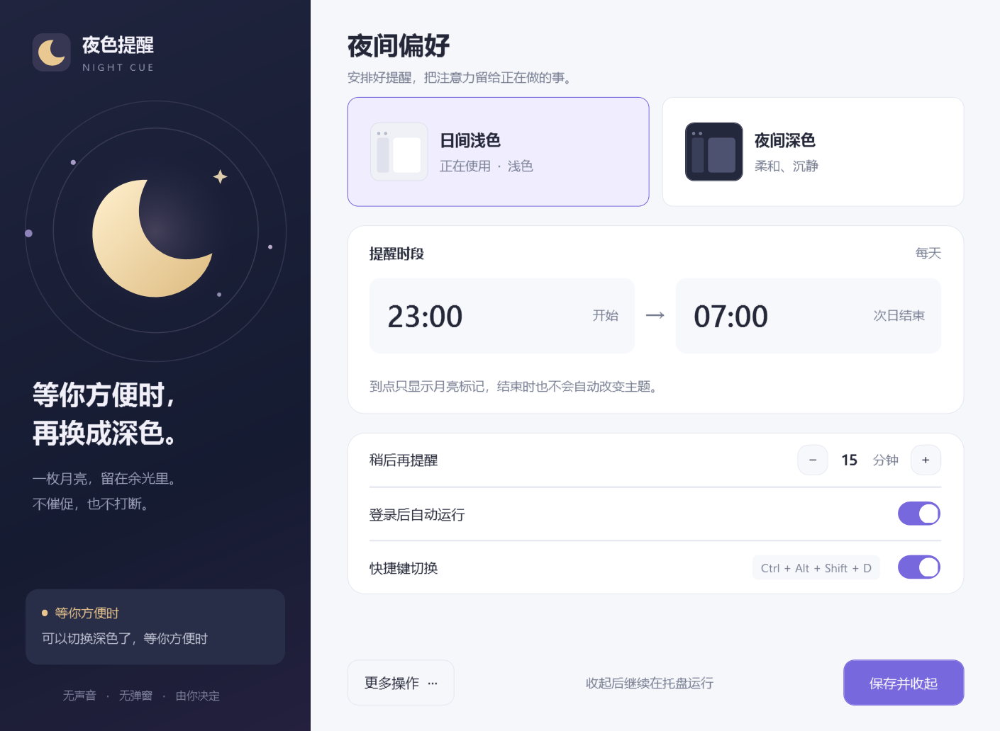
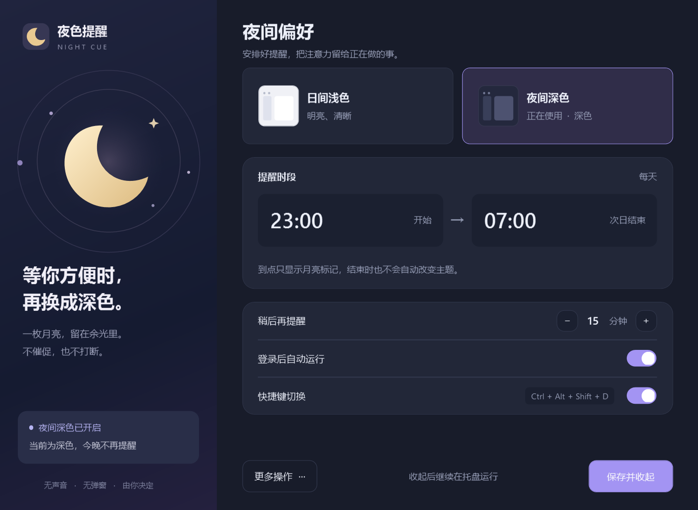

# NightCue · 夜色提醒

**等你关灯，再切换深色。**

[English](README.md) · 简体中文 · [MIT 许可证](LICENSE)

NightCue 是一个安静的 Windows 托盘小工具。到了夜间提醒时间，任务栏里亮起一枚琥珀色月亮；等你关灯或有空时，再选择切换深色、稍后提醒，或者今晚继续使用浅色。

没有声音、通知横幅、闪烁或自动换色。它不会尝试判断你是否专注，也不会检测房间是否开灯。



<details>
<summary>查看深色界面</summary>



</details>

## 功能

- 自定义提醒时段，默认 **23:00 至次日 07:00**，支持跨午夜。
- 等待选择时，托盘显示静止的琥珀色月亮。
- 从托盘菜单，或用 **Ctrl + Alt + Shift + D**，手动切换 Windows 与应用主题。
- 默认延后 **15 分钟**，可设置为 1–120 分钟。
- 支持“今晚保持浅色”，选择与延后时间会跨午夜、重启保留。
- 可选登录启动，设置全部保存在本地，设置窗口随主题切换外观。

当前操作界面为**简体中文**，文档及快速指南提供中英文版。提醒时段结束**不会自动切回浅色**。

## 开始使用

发布后可在本仓库的 **Releases** 页面下载 `NightCue-v1.2.0-windows-portable.zip`。如果尚未发布安装包，请按下方说明从源码构建。

1. 完整解压 ZIP，放到自己有写入权限的文件夹。若使用登录启动，请选择固定位置。
2. 运行 `NightCue.exe`，无需管理员权限。
3. 在 Windows 任务栏设置中显示月亮图标，或从折叠菜单把它拖到时钟旁。
4. 打开“设置”，调整提醒时段，点击“保存并收起”。

| 图标 | 含义 |
| --- | --- |
| 琥珀色月亮 | 已到提醒时间，等你方便时选择 |
| 灰色圆环 | 尚未到时间、正在延后，或今晚已处理 |
| 蓝色月亮 | 系统和应用主题均为深色 |

“15 分钟”仅表示主动选择延后后的等待时间，**不是每隔 15 分钟弹窗**。[完整使用说明](docs/使用说明.txt) · [English quick start](docs/QUICKSTART.en.txt)。

## 运行要求与已知限制

- 已手动验证的桌面环境是 Windows 11。Windows 10 + .NET Framework 4.8 是兼容目标，尚未手动验证；Windows ARM64 也未验证。
- 需要 **.NET Framework 4.8 或更高版本**及 Windows 桌面组件。程序为 AnyCPU，没有第三方运行时包依赖。
- 应用或网站需支持跟随系统主题。固定为某个主题的应用不会被覆盖；系统与应用主题不一致时，视为未完全进入深色。
- 请关闭 PowerToys Light Switch、Auto Dark Mode 等工具的重叠定时切换，避免主题被来回改变。
- 当前程序未签名，Windows 可能显示信誉提示；可核对发布包的校验值，或自行从源码构建。
- 高对比度、读屏和不同缩放比例的多显示器布局尚未全面验证。

## 从源码构建

在已安装 .NET Framework 4.8 的 Windows 上，于项目根目录打开 PowerShell：

```powershell
.\build.ps1
```

脚本使用 Windows 自带的 .NET Framework 编译器，检查项目元数据，随后运行回归检查。它不会启动托盘程序或修改 Windows 设置。本机已验证 PowerShell 7；脚本使用兼容 PowerShell 5.1 的语法，但仍受本机脚本执行策略约束。若脚本被禁止，请使用获准的开发环境或 Visual Studio。

程序输出到 `artifacts/app/NightCue.exe`，测试程序输出到 `artifacts/tests/NightCue.Tests.exe`。使用 Visual Studio 时，安装“.NET 桌面开发”工作负载和“.NET Framework 4.8 目标包”，打开 `NightCue.sln`，构建 Release 并运行测试程序。详见[贡献指南](CONTRIBUTING.md)。

```powershell
# 构建、测试并生成源码包、便携程序包和 SHA-256 校验值
.\scripts\package.ps1
```

GitHub Actions 会在 Windows 上检查两种构建方式，并保存构建产物；正式 Release 由维护者另行发布。[发布指南](docs/PUBLISHING.md)。

## 本地数据、启动与卸载

程序没有网络请求、统计上报或自动更新。`settings.xml`、`state.xml` 和出错时生成的 `error.log` 保存在程序旁边。日志可能包含本地路径，公开提交前请检查。请勿放在 Program Files 等只读位置。

主动切换主题时，仅修改当前用户 `HKCU\Software\Microsoft\Windows\CurrentVersion\Themes\Personalize` 下的 `AppsUseLightTheme` 与 `SystemUsesLightTheme`。启用登录启动时，在 `HKCU\Software\Microsoft\Windows\CurrentVersion\Run` 下添加 `NightCue` 项，不安装服务或计划任务。

卸载时，在设置中关闭“登录后自动运行”并保存，托盘菜单选择“退出”，再删除程序文件夹。当前 Windows 主题会保持你选择的状态。移动文件夹前，请先关闭登录启动，移动后再从新位置启用。[故障排查](docs/TROUBLESHOOTING.md)。

## 参与项目

欢迎用中文或英文提交问题、翻译、无障碍改进与范围明确的代码贡献。请先阅读[贡献指南](CONTRIBUTING.md)、[行为准则](CODE_OF_CONDUCT.md)和[更新记录](CHANGELOG.md)。安全问题请参阅 [SECURITY.md](SECURITY.md)。

## 许可证

[MIT](LICENSE) · Copyright (c) 2026 NightCue contributors。项目代码、原创图形和文档均采用该许可；Windows 与 .NET 遵循各自的许可。
